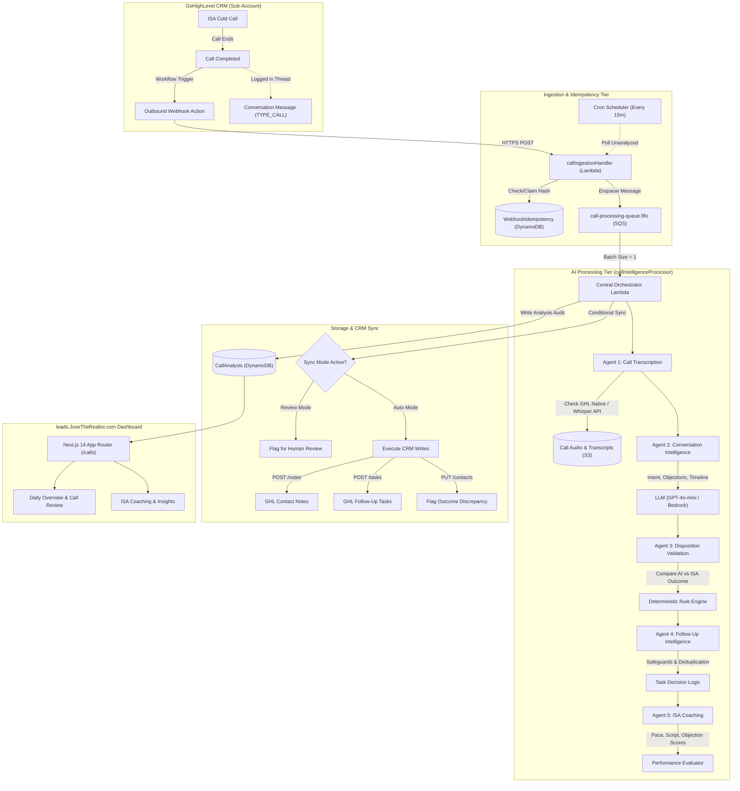
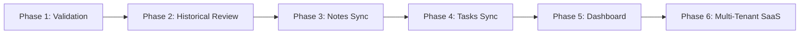

# AI Call Intelligence System Architecture Blueprint
**Target Platform:** `leads.JoseTheRealtor.com`  
**Author:** Principal Software Architect & Senior AWS Serverless Engineer  
**Status:** Architectural Proposal (Pending User Approval — Zero Code Implemented)  
**Date:** March 2026

---

## Executive Summary

This document establishes the production architecture for the **AI Call Intelligence** module on `leads.JoseTheRealtor.com`.

The system inspects cold calls conducted by Inside Sales Agents (ISAs) via GoHighLevel (GHL), automatically accesses authorized call recordings, produces diarized transcripts, extracts verified homeowner intent and objections, validates the human ISA's selected disposition, creates concise CRM notes and follow-up tasks, generates ISA coaching feedback, and populates executive dashboards.

The architecture is strictly **non-intrusive and non-disruptive**:
1. **Zero Cold Outbound AI:** AI will **never** place outbound calls or send unsolicited cold SMS messages.
2. **Architecture First:** Zero implementation code or infrastructure changes have been made.
3. **Deep Codebase Reuse:** Reuses existing Amplify Gen 2 infrastructure, DynamoDB tables, GHL OAuth client with exponential backoff (`apiRetry.ts`), idempotency tables, and token manager.

---

## A. Existing System Audit

A thorough static analysis of the `leads.JoseTheRealtor.com` repository was performed.

### 1. Existing GoHighLevel (GHL) Integration

| Component | Repository Path | Existing Functionality & Reuse Potential |
| :--- | :--- | :--- |
| **OAuth Authorization Flow** | [`app/api/v1/oauth/start/route.ts`](file:///home/fernandez/repos/JoseTheRealtor-amplify-next-template/app/api/v1/oauth/start/route.ts#L37-L69) | Initiates OAuth flow with signed HMAC state tokens (`userId|nonce|timestamp`). **Full reuse.** All required scopes are already configured. |
| **OAuth Callback & Token Exchange** | [`app/api/v1/oauth/callback/route.ts`](file:///home/fernandez/repos/JoseTheRealtor-amplify-next-template/app/api/v1/oauth/callback/route.ts#L125-L185) | Exchanges `code` for `access_token` and `refresh_token` at `https://services.leadconnectorhq.com/oauth/token`. Auto-provisions custom fields on connect. |
| **Server Token DAL** | [`app/utils/aws/data/ghlIntegration.server.ts`](file:///home/fernandez/repos/JoseTheRealtor-amplify-next-template/app/utils/aws/data/ghlIntegration.server.ts) | Centralized token getter (`getValidGhlToken`) that automatically refreshes expired tokens via Amplify SSR client. |
| **Lambda Token Manager** | [`amplify/functions/shared/ghlTokenManager.ts`](file:///home/fernandez/repos/JoseTheRealtor-amplify-next-template/amplify/functions/shared/ghlTokenManager.ts) | High-performance DynamoDB DocumentClient token manager for serverless functions with automatic refresh and location-to-tenant lookup (`getIntegrationByLocationId`). |
| **API Client & Retries** | [`amplify/functions/shared/ghlClient.ts`](file:///home/fernandez/repos/JoseTheRealtor-amplify-next-template/amplify/functions/shared/ghlClient.ts) & [`apiRetry.ts`](file:///home/fernandez/repos/JoseTheRealtor-amplify-next-template/amplify/functions/shared/apiRetry.ts) | Axios client pinned to GHL API version `2021-07-28` with automatic retries on `429`, `502`, `503`, and `504` with jittered exponential backoff and `Retry-After` header parsing. |
| **Webhook Ingestion** | [`amplify/functions/ghlWebhookHandler/handler.ts`](file:///home/fernandez/repos/JoseTheRealtor-amplify-next-template/amplify/functions/ghlWebhookHandler/handler.ts) | Public Function URL handling inbound messages, missed calls, email bounces, and task completions with HMAC signature verification (`x-ghl-signature`). |
| **Idempotency** | [`amplify/functions/shared/idempotency.ts`](file:///home/fernandez/repos/JoseTheRealtor-amplify-next-template/amplify/functions/shared/idempotency.ts) | Atomic conditional DynamoDB puts against `WebhookIdempotency` table with 24h TTL. |
| **Dispositions & Field Provisioner** | [`amplify/functions/shared/dispositions.ts`](file:///home/fernandez/repos/JoseTheRealtor-amplify-next-template/amplify/functions/shared/dispositions.ts) & [`ghlFieldProvisioner.ts`](file:///home/fernandez/repos/JoseTheRealtor-amplify-next-template/amplify/functions/shared/ghlFieldProvisioner.ts) | Provisions 11 picklist choices for the `Call Outcome` custom field (`Not Interested`, `Sold Already`, `Listed With Realtor`, `Wrong Number...`, `DNC`, `Appointment Set`, etc.). |
| **Notes & Task Operations** | [`amplify/functions/shared/conversationActivity.ts`](file:///home/fernandez/repos/JoseTheRealtor-amplify-next-template/amplify/functions/shared/conversationActivity.ts) & [`aiFollowUpAgent/handler.ts`](file:///home/fernandez/repos/JoseTheRealtor-amplify-next-template/amplify/functions/aiFollowUpAgent/handler.ts) | Direct endpoints `POST /contacts/{contactId}/notes` and `POST /contacts/{contactId}/tasks` already implemented in production. |

### 2. Existing AWS Architecture

- **Amplify Gen 2 Backend** ([`amplify/backend.ts`](file:///home/fernandez/repos/JoseTheRealtor-amplify-next-template/amplify/backend.ts)): Uses `@aws-amplify/backend` with CDK constructs. Defines Auth, Data, Storage, and 14 Lambda functions.
- **DynamoDB Models** ([`amplify/data/resource.ts`](file:///home/fernandez/repos/JoseTheRealtor-amplify-next-template/amplify/data/resource.ts)):
  - `PropertyLead`: Core real estate lead table partitioned by Cognito user ID (`owner`).
  - `GhlIntegration`: Multi-tenant OAuth credentials, custom field IDs, and agent settings.
  - `OutreachQueue`: Queue tracking email cadence (`OUTREACH`, `CONVERSATION`, `DND`, `MANUAL_HANDLING`).
  - `WebhookIdempotency`: Atomic locking with TTL.
  - `UserAccount`: Credits, plan tiers, and usage counters.
- **Storage** ([`amplify/storage/resource.ts`](file:///home/fernandez/repos/JoseTheRealtor-amplify-next-template/amplify/storage/resource.ts)): S3 bucket with Cognito group authorization.
- **AI Models & Integrations**:
  - AWS Bedrock runtime client authorized for Claude 3.5 Sonnet (`aiFollowUpAgent`).
  - OpenAI API integration supported via platform key (`OPENAI_API_KEY`) and per-tenant BYOK key (`GhlIntegration.openAiApiKey`).

### 3. Gap Analysis: What Must Be Added

```
+------------------------------------+-----------------------------------------------------+
| Capability                         | Status & Action Required                            |
+------------------------------------+-----------------------------------------------------+
| Call Ingestion Event Trigger       | ADD: GHL Workflow Outbound Webhook + Fallback Sync  |
| Asynchronous Buffer & Retry Queue  | ADD: SQS FIFO Queue (call-processing-queue.fifo)    |
| Recording Media Fetcher            | ADD: Integration with GHL message recording endpoint|
| Speech-to-Text Pipeline            | ADD: Diarized transcription (OpenAI Whisper/AWS)    |
| Multi-Agent LLM Evaluator          | ADD: Intent, disposition & coaching analyzer       |
| Call Intelligence Data Model       | ADD: CallAnalysis DynamoDB table & S3 prefix        |
| Call Intelligence Dashboard        | ADD: Next.js page at app/(protected)/calls/page.tsx |
+------------------------------------+-----------------------------------------------------+
```

---

## B. GoHighLevel (GHL) API Feasibility Report

Research into official HighLevel / LeadConnector API v2 documentation confirmed the following capabilities:

### 1. API Endpoints & Verification Status

| API Operation | HTTP Method & Official Endpoint | Required Scope | Feasibility Status |
| :--- | :--- | :--- | :--- |
| **Fetch Call Recording Media** | `GET https://services.leadconnectorhq.com/conversations/messages/{messageId}/locations/{locationId}/recording` | `conversations/message.readonly` | **VERIFIED.** Returns audio binary or signed redirect URL. Scope already granted in existing OAuth. |
| **Fetch Native GHL Transcript** | `GET https://services.leadconnectorhq.com/conversations/locations/{locationId}/messages/{messageId}/transcription` | `conversations/message.readonly` | **VERIFIED.** Only populated if native LC Phone transcription is enabled on the sub-account. |
| **Search Conversation Messages** | `GET https://services.leadconnectorhq.com/conversations/{conversationId}/messages` | `conversations/message.readonly` | **VERIFIED.** Lists messages where `messageType = "TYPE_CALL"` or `type = 100`. |
| **Search Conversations by Contact** | `GET https://services.leadconnectorhq.com/conversations/search?contactId={contactId}` | `conversations.readonly` | **VERIFIED.** Used in `conversationActivity.ts`. |
| **Create Contact Note** | `POST https://services.leadconnectorhq.com/contacts/{contactId}/notes` | `contacts.write` | **VERIFIED.** Already implemented and active in current codebase. |
| **Create Contact Task** | `POST https://services.leadconnectorhq.com/contacts/{contactId}/tasks` | `locations/tasks.write` or `contacts.write` | **VERIFIED.** Already implemented in `aiFollowUpAgent`. |
| **Get Sub-Account Users** | `GET https://services.leadconnectorhq.com/users/?locationId={locationId}` | `users.readonly` | **VERIFIED.** Used to map ISA user IDs to agent names. |
| **Update Custom Field (Outcome)** | `PUT https://services.leadconnectorhq.com/contacts/{contactId}` | `contacts.write` | **VERIFIED.** Updates `Call Outcome` custom field. |

### 2. Completed Call Event Delivery Analysis

1. **Marketplace App-Level Webhooks:**  
   GHL Marketplace App webhook subscriptions do **not** provide a dedicated global `CallCompleted` event. Marketplace webhooks fire on `InboundMessage`, `OutboundMessage`, and `ContactUpdate`. While completed calls create conversation message entries, relying solely on marketplace message events can encounter inconsistent payload structures across different phone carriers.
2. **Location Workflow Webhook (Recommended Primary Ingestion):**  
   Inside GoHighLevel sub-accounts, the native Workflow Trigger **`Call Details`** with filter `Call Status = Completed` triggers reliably for both inbound and outbound calls. An **`Outbound Webhook`** action in this workflow sends an immediate POST payload containing `contact_id`, `call_duration`, `direction`, `user_id`, and `recording_url`.
3. **Scheduled Synchronization (Reliable Secondary Ingestion):**  
   To guarantee 100% capture even if an ISA triggers calls outside a configured workflow, a scheduled EventBridge Lambda runs every 15 minutes, querying recent calls via `GET /conversations/{id}/messages` and enqueuing any unanalyzed call records.

### 3. Official Documentation References
- HighLevel Conversations API: `https://marketplace.gohighlevel.com/docs/conversations`
- HighLevel Recording & Transcription Endpoints: `https://highlevel.stoplight.io/docs/integrations`
- LeadConnector OAuth Scopes: `https://marketplace.gohighlevel.com/docs/authorization/scopes`

---

## C. Recommended Architecture

The architecture uses an asynchronous, decoupled pipeline to isolate third-party rate limits, audio rendering latencies, and LLM processing times from the user-facing web tier.



### End-to-End Event-Driven Workflow

1. **Call Completion & Delivery:** When an ISA completes a dial in GHL, the sub-account workflow fires an Outbound Webhook to the `callIngestionHandler` Function URL.
2. **Ingestion & Validation:** The handler verifies the HMAC header, parses the payload, validates the tenant `locationId`, and performs an atomic claim in `WebhookIdempotency`.
3. **Buffering via SQS FIFO:** The event is pushed into `call-processing-queue.fifo`. The `MessageGroupId` is set to `tenantId:contactId`, guaranteeing that calls for the same homeowner are processed in strict order without concurrency conflicts.
4. **Recording Availability & Retry:** If GHL indicates the call recording is still rendering (HTTP 404 or incomplete media), the message is deferred via SQS visibility timeout (`ChangeMessageVisibility`) for 60 seconds (up to 5 retries) before sending to a Dead Letter Queue (DLQ).
5. **Transcription (Agent 1):** The orchestrator checks if GHL provided a native transcription. If absent, the audio stream is downloaded into an S3 staging prefix (`s3://.../callRecordings/`) and transcribed using the speech-to-text engine with speaker timestamps.
6. **Multi-Agent Evaluation (Agents 2–5):** The transcript is processed sequentially through deterministic validation and structured LLM extraction.
7. **CRM Safe Synchronization:** In Phase 1–2, analysis is kept in `REVIEW_ONLY` mode. When enabled, factual notes and validated follow-up tasks are created in GHL with strict deduplication guards.
8. **Dashboard Presentation:** The completed record is written to the `CallAnalysis` DynamoDB table and immediately rendered in the Next.js Call Intelligence UI.

---

## D. Multi-Agent System Architecture

To avoid unpredictability and unbounded loop costs, the system uses a **deterministic central orchestrator** coordinating single-responsibility specialized agents.

```
+-----------------------------------------------------------------------------------+
|                        CENTRAL DETERMINISTIC ORCHESTRATOR                         |
+-----------------------------------------------------------------------------------+
       |                    |                    |                   |
       v                    v                    v                   v
[Agent 1: STT]      [Agent 2: Intent]    [Agent 3: Validate]  [Agent 4: FollowUp]
Audio -> Text       Transcript -> Intel  ISA vs AI Outcome    Task Safeguards
                                                                     |
                                                                     v
                                                             [Agent 5: Coaching]
                                                             Script & Performance
```

### Agent 1 — Call Transcription Agent
- **Role:** Secure audio ingestion, audio validation, and speech-to-text transcription.
- **Inputs:** `locationId`, `callId`, `messageId`, `recordingUrl`, GHL OAuth token.
- **Execution Logic:**
  1. Attempt to fetch native transcript via `GET /conversations/locations/{locationId}/messages/{messageId}/transcription`.
  2. If native transcript exists and duration matches audio, return transcript.
  3. If missing: fetch audio stream via `GET /conversations/messages/{messageId}/locations/{locationId}/recording`.
  4. Validate audio length (> 5 seconds; discard instant hang-ups or carrier dead-air).
  5. Stream to staging S3 bucket (`callRecordings/{tenantId}/{callId}.wav`).
  6. Transcribe using OpenAI Whisper API (`whisper-1`) or AWS Transcribe with speaker diarization.
- **Outputs:** Diarized transcript (`{ speaker: 'ISA' | 'OWNER', text: string, timestamp: number }[]`), audio duration, confidence score.
- **Decision Boundary:** Never analyze calls shorter than 5 seconds. If audio is corrupted or silent, mark status `AUDIO_UNAVAILABLE` and abort downstream LLM calls.

### Agent 2 — Conversation Intelligence Agent
- **Role:** Semantic extraction of verified homeowner statements, property facts, and objections.
- **Inputs:** Diarized transcript, lead metadata (owner name, property address, lead type: probate/preforeclosure).
- **Execution Logic:** Executes structured JSON schema extraction using `gpt-4o-mini` with strict system constraints.
- **Extracted Attributes:**
  - `homeownerInterest`: `DEFINITE_NO`, `CONDITIONAL_NO`, `CURIOUS`, `INTERESTED`, `NOT_OWNER`, `UNAVAILABLE`.
  - `sellingTimeline`: Explicit months/years mentioned, or `NONE_STATED`.
  - `reasonsForNotSelling`: Explicit objections (e.g., "staying in family", "just refinanced", "dispute with sibling").
  - `propertyConditionNotes`: Any physical repair or condition details directly stated.
  - `decisionMakers`: Other family members, attorneys, or co-executors mentioned.
  - `unansweredQuestions`: Questions asked by the homeowner that the ISA could not answer.
- **Decision Boundary:** **Hallucination Prevention Guard:** The model is constrained to extract only explicitly stated facts. It is forbidden from inferring seller distress, motivation, or timelines not directly spoken by the contact.

### Agent 3 — Disposition Validation Agent
- **Role:** Audit ISA data hygiene and flag discrepancies between the human-selected disposition and call reality.
- **Inputs:** ISA's selected GHL `Call Outcome`, Agent 2 intelligence output.
- **Execution Logic (Deterministic Rule Matrix):**
  - If ISA logged `Not Interested` but homeowner said *"Call me back next month when probate closes"*, flag: `UNDER_DISPOSITIONED` (recommend `Timeline / Not Ready Yet`).
  - If ISA logged `Appointment Set` but transcript contains only voicemail or no confirmation, flag: `FALSE_POSITIVE`.
  - If ISA logged `Wrong Number` and homeowner confirmed identity, flag: `INCORRECT_DISPOSITION`.
  - If ISA logged `No Answer` but a 3-minute conversation occurred, flag: `MISSED_DISPOSITION`.
- **Outputs:** `discrepancyDetected` (boolean), `discrepancySeverity` (`LOW` | `MEDIUM` | `HIGH`), `recommendedDisposition`, `explanation`.
- **Decision Boundary:** Version 1 will **never** automatically overwrite the human ISA's selected disposition in GHL. It flags the discrepancy in the dashboard and records it in the audit log for manager review.

### Agent 4 — Follow-Up Intelligence Agent
- **Role:** Determine whether CRM tasks or callback reminders are legally and commercially warranted.
- **Inputs:** Transcript, extracted callback requests, existing GHL tasks for this contact.
- **Safeguards & Execution Logic:**
  1. **DNC / Opt-Out Absolute Stop:** If homeowner stated *"do not call"*, *"remove my number"*, or *"stop calling"*, the agent **strictly forbids** any follow-up task and flags for `DND` suppression.
  2. **Definite No Stop:** If homeowner explicitly stated they will never sell or are not interested without an invitation for future contact, no task is created.
  3. **Verified Callback Extraction:** If homeowner explicitly requested a callback (e.g., *"Call me back Tuesday afternoon"*), calculate the due date relative to the call timestamp and lead timezone.
  4. **Ambiguity Rule:** If homeowner statement is vague (e.g., *"Maybe later"*), create a `Manager Review` recommendation rather than an automated high-priority callback.
  5. **Deduplication:** Check GHL tasks via `GET /contacts/{contactId}/tasks`. If an open task exists within 7 days, suppress creation.
- **Outputs:** `createTask` (boolean), `taskTitle`, `taskDueDate`, `taskPriority` (`HIGH` | `MEDIUM` | `LOW`), `assignedUserId`.

### Agent 5 — ISA Coaching Agent
- **Role:** Objective evaluation of cold calling communication skills and script adherence.
- **Inputs:** Diarized transcript, call duration, talk-to-listen ratio.
- **Evaluation Criteria:**
  - `openingClarity`: Did the ISA clearly state their name, brokerage, and purpose within the first 15 seconds?
  - `objectionHandling`: When faced with initial resistance, did the ISA acknowledge the homeowner's point before asking an open discovery question, or did they prematurely surrender?
  - `interruptionCount`: Did the ISA speak over the homeowner?
  - `listeningRatio`: Percentage of call duration the homeowner was speaking.
  - `actionableCoachingTip`: One specific, constructive behavioral suggestion referencing transcript quotes.
- **Decision Boundary:** Objective behavioral metrics only. Does not evaluate accent, nationality, or subjective vocal timbre. Lead hostility is isolated so the ISA is not penalized for reaching an unreceptive homeowner.

---

## E. Proposed Data Model

To preserve backward compatibility, these schemas extend Amplify Gen 2 and DynamoDB without altering existing tables.

### 1. Amplify Gen 2 Schema Definition (`amplify/data/resource.ts`)

```typescript
// AI Call Intelligence Model (Design Proposal)
CallAnalysis: a
  .model({
    userId: a.string().required(),          // Cognito tenant ID (owner)
    locationId: a.string().required(),      // GHL sub-account ID
    contactId: a.string().required(),       // GHL contact ID
    callId: a.string().required(),          // GHL message/call ID
    conversationId: a.string(),            // GHL conversation ID
    
    // Call Metadata
    callTimestamp: a.datetime().required(),
    callDurationSeconds: a.integer().default(0),
    callDirection: a.enum(['INBOUND', 'OUTBOUND']),
    isaUserId: a.string(),                 // GHL User ID of the ISA
    isaName: a.string(),
    contactPhone: a.string(),
    contactName: a.string(),
    propertyAddress: a.string(),
    leadType: a.string(),                  // 'PROBATE' | 'PREFORECLOSURE'
    
    // Media & Transcription
    recordingUrl: a.string(),              // GHL or S3 authorized recording reference
    recordingStorageKey: a.string(),       // S3 key in secure bucket
    transcriptStorageKey: a.string(),      // S3 key for full diarized JSON transcript
    transcriptSnippet: a.string(),         // First 500 chars for instant UI preview
    transcriptionSource: a.enum(['GHL_NATIVE', 'WHISPER_API', 'AWS_TRANSCRIBE']),
    
    // AI Conversation Analysis
    summary: a.string().required(),
    sellerIntent: a.enum(['DEFINITE_NO', 'CONDITIONAL_NO', 'CURIOUS', 'INTERESTED', 'WRONG_NUMBER', 'UNAVAILABLE']),
    sellingTimeline: a.string(),
    objections: a.string().array(),
    propertyConditionNotes: a.string(),
    decisionMakersInvolved: a.string(),
    
    // Disposition Audit
    originalDisposition: a.string().required(), // Human ISA selection
    aiRecommendedDisposition: a.string().required(),
    dispositionDiscrepancy: a.boolean().default(false),
    discrepancyReason: a.string(),
    discrepancySeverity: a.enum(['NONE', 'LOW', 'MEDIUM', 'HIGH']),
    
    // Follow-Up Recommendations
    followUpWarranted: a.boolean().default(false),
    followUpReason: a.string(),
    followUpDueDate: a.datetime(),
    ghlTaskId: a.string(),                 // ID of created task in GHL (if synced)
    ghlNoteId: a.string(),                 // ID of created note in GHL (if synced)
    
    // ISA Coaching
    coachingScore: a.integer(),            // 1-100 overall call score
    openingEffectiveness: a.enum(['EXCELLENT', 'GOOD', 'NEEDS_WORK']),
    talkToListenRatio: a.float(),          // ISA talk time / Owner talk time
    objectionHandlingScore: a.enum(['STRONG', 'ADEQUATE', 'SURRENDERED', 'NOT_APPLICABLE']),
    coachingFeedback: a.string(),
    
    // Lifecycle & Operational Fields
    processingStatus: a.enum([
      'PENDING',
      'RECORDING_FETCH',
      'TRANSCRIBING',
      'ANALYZING',
      'COMPLETED',
      'FAILED',
      'SKIPPED_TOO_SHORT'
    ]),
    syncStatus: a.enum(['REVIEW_ONLY', 'PENDING_SYNC', 'SYNCED', 'SYNC_FAILED']),
    errorMessage: a.string(),
    modelUsed: a.string(),
    estimatedCostUsd: a.float().default(0.0),
    reviewedByManager: a.boolean().default(false),
    managerNotes: a.string(),
  })
  .authorization((allow) => [
    allow.owner().to(['create', 'read', 'update', 'delete']),
    allow.groups(['ADMINS']).to(['create', 'read', 'update', 'delete']),
  ])
  .secondaryIndexes((index) => [
    index('userId').sortKeys(['callTimestamp']).queryField('callsByUserAndDate'),
    index('locationId').sortKeys(['callTimestamp']).queryField('callsByLocationAndDate'),
    index('contactId').queryField('callsByContactId'),
    index('callId').queryField('byCallId'),
  ]),

// Per-Tenant Configuration Model
CallIntelligenceSettings: a
  .model({
    userId: a.string().required(),
    locationId: a.string().required(),
    autoSyncNotes: a.boolean().default(false),    // Review-only by default
    autoCreateTasks: a.boolean().default(false),  // Review-only by default
    minCallDurationSeconds: a.integer().default(10), // Skip dials < 10s
    recordingsRetentionDays: a.integer().default(60), // Auto-expiry
    dailySpendCapUsd: a.float().default(10.0),
    alertOnHighDiscrepancy: a.boolean().default(true),
    managerNotificationEmail: a.string(),
  })
  .authorization((allow) => [
    allow.owner().to(['create', 'read', 'update', 'delete']),
    allow.groups(['ADMINS']).to(['create', 'read', 'update', 'delete']),
  ])
  .identifier(['userId']),
```

---

## F. API & Event Contracts

### 1. Ingestion Webhook Payload (GHL Workflow -> Lambda)
```json
{
  "type": "CallDetails",
  "locationId": "loc_abc12345",
  "contactId": "cnt_98765432",
  "userId": "usr_isa_001",
  "call": {
    "id": "msg_call_112233",
    "direction": "outbound",
    "status": "completed",
    "duration": 142,
    "recordingUrl": "https://services.leadconnectorhq.com/conversations/messages/msg_call_112233/locations/loc_abc12345/recording",
    "callOutcome": "Not Interested",
    "startedAt": "2026-03-30T14:32:00Z"
  },
  "contact": {
    "name": "Robert Miller",
    "phone": "+17325550199",
    "email": "rmiller@example.com"
  }
}
```

### 2. SQS Processing Event Contract (`call-processing-queue.fifo`)
```json
{
  "version": "1.0",
  "eventId": "evt_778899aabb",
  "tenantId": "cognito-sub-1234",
  "locationId": "loc_abc12345",
  "contactId": "cnt_98765432",
  "callId": "msg_call_112233",
  "isaUserId": "usr_isa_001",
  "callTimestamp": "2026-03-30T14:32:00Z",
  "duration": 142,
  "originalDisposition": "Not Interested",
  "retryCount": 0
}
```

### 3. Factual CRM Note Contract (Written to `POST /contacts/{contactId}/notes`)
```
📞 AI CALL SUMMARY — 03/30/2026 (Duration: 2m 22s | ISA: John Doe)
-------------------------------------------------------------------
• Stated Intent: Homeowner is not currently accepting offers.
• Key Details: Property is in probate. Inherited with brother who lives in Florida. 
• Objections: Wants to resolve estate debts before considering any sale.
• Timeline: Did not provide an immediate timeline; suggested checking back in Autumn.
• ISA Outcome Logged: "Not Interested"
• AI Finding: Valid terminal status. No automated follow-up scheduled.
```

### 4. GHL Task Creation Contract (Written to `POST /contacts/{contactId}/tasks`)
```json
{
  "title": "Follow Up: Check in regarding estate resolution (Per Call 03/30)",
  "dueDate": "2026-09-15T13:00:00Z",
  "description": "Owner mentioned resolving estate debts with brother by early fall. Verified call permission granted.",
  "assignedTo": "usr_isa_001",
  "status": "undone"
}
```

---

## G. Security, Privacy & Compliance Architecture

### 1. Two-Party Wiretap & Consent Architecture
- Federal law (18 U.S.C. § 2511) requires one-party consent, but approximately 11 states (including California, Florida, Massachusetts, Pennsylvania) enforce **all-party / two-party wiretap consent**.
- Cold calling out-of-state property owners creates multi-jurisdictional exposure.
- **System Safeguards:**
  1. The system detects the recipient area code and property state.
  2. For leads in two-party states, the system validates whether GHL's pre-call automated recording disclosure was played or whether the ISA explicitly stated *"This call is recorded."*
  3. If consent is disputed or missing in two-party states, the recording is flagged and access restricted.

### 2. TCPA & Telemarketing Compliance
- The AI Call Intelligence system is purely **analytical and diagnostic**. It does not place calls, generate artificial voices, or send bulk SMS.
- **Opt-Out / DNC Precedence:** If a homeowner states *"do not call"*, the system's deterministic engine overrides all other recommendations:
  - Updates GHL `Call Outcome` to **`DNC`**.
  - Sets app internal `OutreachQueue.queueStatus = 'DND'`.
  - Blocks any subsequent task creation.

### 3. Media Security & Data Retention Lifecycle
- **Zero Public S3 Buckets:** Staged audio files and full transcripts are stored in an encrypted S3 bucket using AWS KMS (`aws/s3`).
- **Short-Lived Signed URLs:** The Next.js dashboard plays recordings via S3 pre-signed URLs valid for a maximum of 15 minutes.
- **Automated Expiry Policy:** S3 Lifecycle Rules automatically transition recordings to Glacier after 30 days and permanently delete them after 90 days. Transcripts and structured analysis records are retained in DynamoDB for analytics.

---

## H. AI Cost Analysis & Unit Economics

### 1. Cost Parameters & Assumptions
- Average cold call duration with answered connection: **2.0 minutes** (120 seconds).
- Unanswered / voicemail calls skipped by duration filter (< 10 seconds): **$0.00**.
- **Speech-to-Text (STT):** OpenAI Whisper API at **$0.006 per minute** ($0.012 per 2-minute call).
- **LLM Intelligence & Coaching:** OpenAI `gpt-4o-mini` (~1,500 input tokens + 350 output tokens):
  - Input: 1,500 tokens × $0.15 / 1,000,000 = $0.000225
  - Output: 350 tokens × $0.60 / 1,000,000 = $0.000210
  - Total LLM cost per call: **~$0.000435**
- **AWS Serverless Compute & Storage:** SQS, Lambda, DynamoDB, S3: **~$0.0005 per call**.
- **Total Blended Cost per Analyzed Call:** **~$0.013 – $0.015** (approx. 1.3 to 1.5 cents).

### 2. Projected Monthly Spend by Volume

```
+--------------------+--------------------+--------------------+--------------------+
| Monthly Calls      | Transcription Cost | LLM & AWS Compute  | Total Monthly Cost |
| Analyzed           | (Whisper @ $0.012) | (Inference & Infr) | (USD)              |
+--------------------+--------------------+--------------------+--------------------+
| 500 calls          | $6.00              | $0.47              | $6.47              |
| 1,000 calls        | $12.00             | $0.94              | $12.94             |
| 5,000 calls        | $60.00             | $4.68              | $64.68             |
| 10,000 calls       | $120.00            | $9.35              | $129.35            |
+--------------------+--------------------+--------------------+--------------------+
```

> [!TIP]
> **Cost Optimization Levers:**
> 1. Filtering calls shorter than 10 seconds eliminates ~60–70% of dials (no-answers and instant hangups) before touching transcription or LLM APIs.
> 2. Leveraging native GHL transcripts when already enabled in the user's sub-account saves 100% of the Whisper STT fee.
> 3. Caching call analysis by GHL `messageId` prevents duplicate processing upon retries.

---

## I. Phased Implementation Roadmap



### Phase 1 — GHL Integration Validation
- **Deliverables:** Verify live API audio fetching using Jose's connected GHL account. Confirm URL formats, audio codec compatibility, and webhook delivery.
- **Dependencies:** GHL OAuth credentials and test call in sub-account.
- **Complexity:** Low.
- **Risks:** GHL audio URL requiring specific redirect or custom header authentication.
- **Acceptance Criteria:** Successfully fetch and play an audio recording from an existing GHL call ID.

### Phase 2 — Historical Call Analysis (Read-Only)
- **Deliverables:** Deploy SQS queue and processor Lambda. Ingest 50–100 historical calls into DynamoDB without writing to GHL.
- **Dependencies:** Phase 1 completion; `CallAnalysis` DynamoDB table provisioned.
- **Complexity:** Medium.
- **Risks:** Model hallucinating timelines or seller motivation.
- **Acceptance Criteria:** 100 calls analyzed; zero writes to GHL; human review of summaries confirms > 95% factual accuracy.

### Phase 3 — CRM Notes Automation
- **Deliverables:** Enable automated posting of concise, factual CRM notes to GHL contacts.
- **Dependencies:** Phase 2 accuracy verification.
- **Complexity:** Low.
- **Risks:** Cluttering CRM notes if duplicate webhooks occur.
- **Acceptance Criteria:** Deduplication prevents duplicate notes; notes read clearly and factually.

### Phase 4 — Follow-Up Task Automation
- **Deliverables:** Enable automated GHL task creation for legitimate callbacks with human review toggle.
- **Dependencies:** Phase 3 completion; task deduplication logic.
- **Complexity:** Medium.
- **Risks:** Scheduling follow-ups for opt-outs or vague statements.
- **Acceptance Criteria:** DNC requests create 0 tasks; ambiguous requests flag for manager review; explicit requests create correctly dated tasks.

### Phase 5 — Dashboard & ISA Coaching UI
- **Deliverables:** Build Next.js 14 dashboard at `app/(protected)/calls/page.tsx` with metrics, transcripts, audio playback, and coaching trends.
- **Dependencies:** Phases 1–4.
- **Complexity:** High.
- **Risks:** High latency when querying large call sets.
- **Acceptance Criteria:** Sub-second filter queries using secondary indexes; clean responsive UI matching the existing Tailwind design system.

### Phase 6 — SaaS Commercialization
- **Deliverables:** Add per-tenant usage caps, BYOK OpenAI key management, and subscription gating (`AI_PLAN` tier enforcement).
- **Dependencies:** Phase 5 completion.
- **Complexity:** Medium.
- **Risks:** Tenant exceeding daily spend.
- **Acceptance Criteria:** Hard spend caps enforced; tenant isolation verified.

---

## J. Open Questions & Items Requiring Account Verification

Before initiating Phase 1, the following items should be verified on Jose's live GoHighLevel sub-account:

1. **Native Transcription Setting:** Does Jose's current GHL sub-account already have LC Phone call transcription enabled, or will our system be the primary transcriber for all calls?
2. **Workflow Webhook Configuration:** Does Jose have admin permissions in the target GHL sub-account to add the "Call Details -> Outbound Webhook" automation, or should we rely primarily on scheduled polling in the initial release?
3. **Current ISA Dial Volume:** What is the average number of completed calls per day conducted by the ISA? (This will determine whether SQS standard batching or single-message immediate processing is optimal).
4. **ISA User ID Assignment:** Should AI-created follow-up tasks be assigned back to the specific ISA who made the call, or directly to Jose?

---

*This architectural blueprint is complete and awaits user review and approval before any code or infrastructure changes are introduced.*
