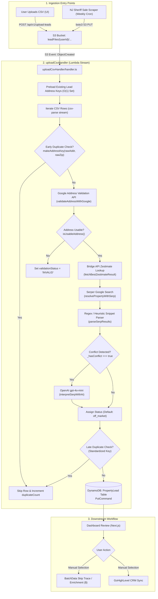
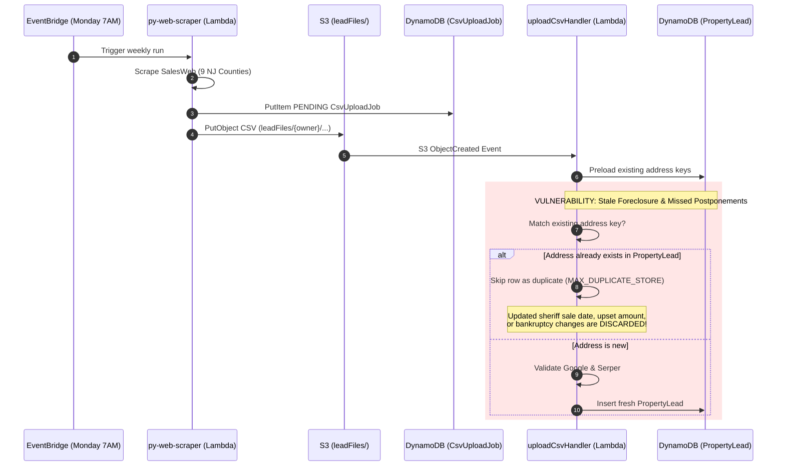
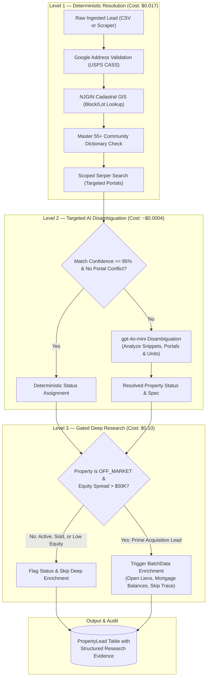
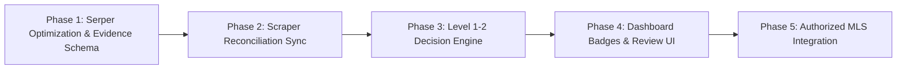

# AI Property Intelligence Engine — Architecture & Feasibility Audit
**Target Platform:** `leads.JoseTheRealtor.com`  
**Role:** Principal Software Architect & Real Estate Systems Engineer  
**Status:** Architecture & Feasibility Audit (Zero Code Changes — Pure Analysis)  
**Date:** March 2026

---

## Executive Summary

This audit evaluates the feasibility, data quality, cost structure, and architectural design for an **AI Property Intelligence Engine** within `leads.JoseTheRealtor.com`.

The primary business objective is to eliminate inaccurate property listing statuses (such as false off-market or misidentified active/sold statuses), improve property classification (single family vs. condo vs. 55+), and audit the end-to-end lead ingestion pipeline—including the external **NJ Sheriff Sale Scraper** (`py-web-scraper`)—without inflating API operating costs.

### Key Audit Findings

1. **Root Cause of Listing Status Inaccuracy:**  
   In [`app/utils/serpPropertyResolver.server.ts`](file:///home/fernandez/repos/JoseTheRealtor-amplify-next-template/app/utils/serpPropertyResolver.server.ts#L520), the system defaults to `'off_market'` whenever search snippets contain no recognized listing keywords. This falsely assumes that *absence of a search snippet equals an off-market property*. Furthermore, broad search queries allow neighboring homes, differing condo units, and stale search cache entries to pollute results.
2. **Scraper Disconnect & Missed Updates:**  
   The existing Python scraper (`py-web-scraper`) runs weekly via Amazon EventBridge, scraping SalesWeb across 9 NJ counties and uploading CSVs to S3. However, because [`uploadCsvHandler/handler.ts`](file:///home/fernandez/repos/JoseTheRealtor-amplify-next-template/amplify/functions/uploadCsvHandler/handler.ts#L488) employs an early duplicate check by address and ZIP, **subsequent auction updates, postponements, adjournments, or completed sheriff sales for existing leads are completely ignored**.
3. **Architectural Recommendation (Level 1–3 Hybrid):**  
   Rather than deploying an expensive, unconstrained swarm of autonomous AI agents for every imported lead, we recommend a **Cost-Gated 3-Level Decision Engine**:
   - **Level 1 (Deterministic & Free/Low-Cost):** Enhanced address/unit normalization, query scoping (`site:zillow.com OR site:redfin.com OR site:realtor.com`), and cadastral parcel resolution.
   - **Level 2 (Targeted AI Disambiguation):** Trigger `gpt-4o-mini` only when portal signals conflict or match confidence is below 85% (~15–20% of leads).
   - **Level 3 (Deep Enrichment & Verification):** Perform BatchData enrichment and title/lien analysis only after confirming the property is off-market and has equity, avoiding wasted skip-trace credits on active MLS listings.

---

## 1. Audit of the Existing Lead Import Pipeline

Static analysis of the upload infrastructure ([`amplify/backend.ts`](file:///home/fernandez/repos/JoseTheRealtor-amplify-next-template/amplify/backend.ts#L49-L99), [`amplify/functions/uploadCsvHandler/handler.ts`](file:///home/fernandez/repos/JoseTheRealtor-amplify-next-template/amplify/functions/uploadCsvHandler/handler.ts), [`app/api/v1/upload-leads/route.ts`](file:///home/fernandez/repos/JoseTheRealtor-amplify-next-template/app/api/v1/upload-leads/route.ts)) reveals the complete current-state data flow:

### 1.1 Ingestion Flow & Lifecycle Questions Answered

1. **What happens when a CSV is uploaded?**  
   The user uploads a file through [`app/(protected)/upload/page.tsx`](file:///home/fernandez/repos/JoseTheRealtor-amplify-next-template/app/(protected)/upload/page.tsx). The client POSTs to [`app/api/v1/upload-leads/route.ts`](file:///home/fernandez/repos/JoseTheRealtor-amplify-next-template/app/api/v1/upload-leads/route.ts), which creates a `PENDING` record in DynamoDB (`CsvUploadJob`) with the user's column mapping, and uploads the CSV file to S3.
2. **Where is the file stored?**  
   S3 Bucket defined in [`amplify/storage/resource.ts`](file:///home/fernandez/repos/JoseTheRealtor-amplify-next-template/amplify/storage/resource.ts) under key:  
   `leadFiles/{userId}/{timestamp}-{filename}.csv`.
3. **Which Lambda processes the import?**  
   [`amplify/functions/uploadCsvHandler`](file:///home/fernandez/repos/JoseTheRealtor-amplify-next-template/amplify/functions/uploadCsvHandler/handler.ts), triggered directly via S3 `OBJECT_CREATED_PUT` event notification.
4. **When is Google Address Validation executed?**  
   Executed per row during stream parsing ([line 553](file:///home/fernandez/repos/JoseTheRealtor-amplify-next-template/amplify/functions/uploadCsvHandler/handler.ts#L553)), throttled at ~50 QPS (`GOOGLE_API_DELAY_MS = 20`).
5. **When is Serper called?**  
   Executed per row immediately following address validation ([line 837](file:///home/fernandez/repos/JoseTheRealtor-amplify-next-template/amplify/functions/uploadCsvHandler/handler.ts#L837)), provided the address is verified usable and `SERPER_API_KEY` is present.
6. **When is Zillow called?**  
   Bridge API Zestimate ([line 796](file:///home/fernandez/repos/JoseTheRealtor-amplify-next-template/amplify/functions/uploadCsvHandler/handler.ts#L796)) is called immediately prior to Serper. If Bridge fails or has no match, Serper searches for a Zillow ZPID; if found, Serper re-calls Bridge API via ZPID ([line 625 of serpPropertyResolver](file:///home/fernandez/repos/JoseTheRealtor-amplify-next-template/app/utils/serpPropertyResolver.server.ts#L625)).
7. **Where does basic property record data originate?**  
   Extracted directly from the CSV columns (court filings, probate admin records, county foreclosure filings) and enriched by Google components and Serper snippets.
8. **Sequential vs. Concurrent operations:**  
   Stream processing is **strictly sequential per row** with throttling delays (`BRIDGE_API_DELAY_MS = 50`, `GOOGLE_API_DELAY_MS = 20`) to stay within Lambda memory limits and API rate caps.
9. **Failures and Retries:**  
   If Bridge API credentials fail, a circuit breaker trips (`bridgeAuthFailed = true`), skipping Zestimates for remaining rows while allowing the import to complete. Individual row errors are counted in `errorCount` without halting the stream.
10. **Storage of Results:**  
    Leads are written to the `PropertyLead` DynamoDB table. Job status and progress counters are maintained in `CsvUploadJob`.
11. **Duplicate Detection:**  
    Pre-loads all existing address keys (`makeAddressKey(addr, zip)`) into memory. Duplicates are rejected at two stages: early (raw address) and late (after Google standardization).
12. **Acceptance vs. Rejection:**  
    Rows with unconfirmed/partial addresses are flagged `validationStatus = 'INVALID'` but still stored for manual correction. Rows with emails in non-contact fields are rejected to prevent cold outreach spam violations.
13. **Skip Tracing Stage:**  
    **Manual/On-Demand.** Skip tracing does *not* occur during CSV upload. Users initiate skip tracing from the dashboard after reviewing imported leads.
14. **Incurred API Costs during Import:**  
    Google Address Validation ($0.017/call) + Bridge API Zestimate + Serper Google Search ($0.001/call) + OpenAI `gpt-4o-mini` (only if Serper detects conflicting portal signals).

---

## 2. Current Import & Research Flow



---

## 3. Audit of Existing Serper Listing Research

### 3.1 Code Architecture Breakdown

The listing resolution logic is housed in [`app/utils/serpPropertyResolver.server.ts`](file:///home/fernandez/repos/JoseTheRealtor-amplify-next-template/app/utils/serpPropertyResolver.server.ts) and [`app/utils/ai/serpInterpreter.server.ts`](file:///home/fernandez/repos/JoseTheRealtor-amplify-next-template/app/utils/ai/serpInterpreter.server.ts).

- **Query Construction ([line 550](file:///home/fernandez/repos/JoseTheRealtor-amplify-next-template/app/utils/serpPropertyResolver.server.ts#L550)):**  
  `const query = `${streetQuery} ${city} ${state} ${zip || ''}`.trim();`  
  Where `streetQuery` is `("${address}" OR "${normalizedStreet}")`.
- **Search Parameters ([line 560](file:///home/fernandez/repos/JoseTheRealtor-amplify-next-template/app/utils/serpPropertyResolver.server.ts#L560)):**  
  `{ q: query, num: 8, gl: 'us', hl: 'en' }` via HTTP POST to `https://google.serper.dev/search`.
- **Number of Results:** Exactly 8 organic search results retrieved per property.
- **Address Matching ([line 148](file:///home/fernandez/repos/JoseTheRealtor-amplify-next-template/app/utils/serpPropertyResolver.server.ts#L148)):**  
  `isResultMatchingAddress()` extracts base street numbers and core street names via regex. Rejects neighboring house numbers.
- **AI Disambiguation ([line 580](file:///home/fernandez/repos/JoseTheRealtor-amplify-next-template/app/utils/serpPropertyResolver.server.ts#L580)):**  
  Calls OpenAI `gpt-4o-mini` when `_hasConflict` is true (e.g. recent sold signal + explicit off-market text, or active + sold signal).

### 3.2 Detailed Failure Analysis: Why Listing Status Is Inaccurate

| Failure Mode | Exact Code Root Cause | Real-World Failure Scenario |
| :--- | :--- | :--- |
| **1. False Off-Market Assumption** | Line 520: `else { result.listingStatus = 'off_market'; }` | If Google returns 8 general municipal, tax, or directory snippets that do not explicitly contain keywords like "for sale" or "sold", the property is **silently classified as off-market**. An active MLS listing not indexed on page 1 of Google is marked off-market. |
| **2. Unscoped Search Queries** | Line 555: Query searches the entire web without portal scoping (`site:zillow.com`, etc.). | Local news articles, obituary notices, or deed records push authoritative Zillow/Realtor.com listings out of the top 8 organic results. |
| **3. Condo / Unit Confusion** | Line 138: Strips unit identifiers (`Unit`, `Apt`, `#`, `Suite`) from `coreStreet`. | For condominiums (e.g., `100 Grand Ave, Unit 3B`), snippets from Unit 1A, Unit 2C, or the general building page match the base address regex, attributing another unit's sale or active listing to the target lead. |
| **4. Stale Search Cache & Snippet Lag** | Reliance on Google's search index rather than live MLS APIs. | A property sold 3 weeks ago or placed under contract yesterday still shows Google's cached snippet from 2 months prior ("Active - $450,000"). |
| **5. Coarse Status Schema** | Line 29: Only 4 statuses supported: `'active' \| 'sold' \| 'pending' \| 'off_market'`. | `Withdrawn`, `Expired`, `Contingent`, and `Coming Soon` cannot be represented and get collapsed into `off_market` or `active`. |
| **6. Stored Evidence Amnesia** | Line 897 of `uploadCsvHandler`: Only the scalar string `finalListingStatus` is persisted in `PropertyLead`. | The snippet text, source portal link, match confidence score, and timestamp are **discarded**, making it impossible to audit or re-verify status without paying for another Serper call. |

### 3.3 Immediate Serper Improvements (Zero Additional API Costs)

Before paying for new third-party APIs, the following targeted improvements can be implemented in the existing Serper integration:

1. **Targeted Domain Queries:** Modify search query to explicitly include primary real estate aggregators:  
   `"42 West Louis Pl" "Freehold" NJ (site:zillow.com OR site:redfin.com OR site:realtor.com OR site:homes.com)`
2. **Explicit Unit Preservation:** When the address has a unit number, require the unit number in the regex match before accepting a snippet.
3. **Eliminate the False Off-Market Default:** If no authoritative real estate portal snippet is returned, mark status as `'unknown'` / `'unverified'` rather than `'off_market'`.
4. **Persist Research Evidence:** Store source URLs, snippets, and resolution timestamps in a JSON field (`listingEvidence`) on `PropertyLead`.

---

## 4. Audit of the NJ Sheriff Sale Scraper Integration (`py-web-scraper`)

The investigation located the complete external Python scraper codebase at `../py-web-scraper` (`README.md`, `main.py`, `lambda_handler.py`).

### 4.1 Scraper Architecture & Runtime Environment

- **Repository:** `../py-web-scraper`
- **Execution Environment:** AWS Lambda function (`nj-salesweb-foreclosure-scraper`), packaged via `deploy_aws.sh` and deployed via GitHub Actions OIDC.
- **Scheduling:** Amazon EventBridge rule (`nj-salesweb-weekly-scrape`) firing every **Monday at 11:00 UTC (7:00 AM EDT / 6:00 AM EST)**.
- **Target Source:** SalesWeb portal (`salesweb.civilview.com`) covering **9 New Jersey Counties**: Bergen, Essex, Hudson, Middlesex, Monmouth, Morris, Ocean, Passaic, and Union.
- **Data Extracted:** `sheriff_number`, `court_case_number`, `sales_date`, `days_until_sale`, `street`, `city`, `state`, `zip_code`, `defendant` (borrower), `plaintiff` (lender), `loan_amount`, `approx_upset`, `estimated_upset`, `attorney`, `attorney_phone`, `parcel_id`, `block`, `lot`, `occupancy_status`, `is_probate_or_deceased`.
- **Pre-Filtering:**
  - `MIN_DAYS_RUNWAY = 30`: Only sales scheduled at least 30 days out.
  - Zero past adjournments: Scrapes detail page `#longTable`; rejects any property with past adjournments, bankruptcy stays, or litigation holds.
  - Entity filter: Excludes LLCs, Corporations, and Trusts.
  - Reverse mortgage filter: Excludes HECM lenders.
- **Address Resolution:** Calls the State of New Jersey's official Cadastral GIS REST API (`maps.nj.gov`) by County + Block + Lot whenever street or ZIP is missing.

### 4.2 Ingestion & Disconnect Vulnerabilities



### 4.3 Why Sheriff Sale Leads Become Stale
1. **No Upsert Mechanism:** In `uploadCsvHandler`, duplicate detection is purely suppressive. When SalesWeb updates an auction date (e.g. sale adjourned from April 15 to June 20), the scraper detects it on SalesWeb, but the upload handler discards the row because the property address already exists.
2. **Auction Status vs. Listing Status:** The scraper captures auction date, but does not verify if the homeowner already listed with an agent or sold the home to an investor prior to auction.
3. **Zero Post-Auction Reconciliation:** There is no automated job to check whether the sheriff sale actually occurred, was cancelled by bank payoff, or went back to the bank as REO.

---

## 5. Evaluation of AI Research Components

```
+------------------------------------+------------------------------------+------------------------+
| Component                          | Recommended Implementation         | AI vs. Deterministic   |
+------------------------------------+------------------------------------+------------------------+
| A. Property Identity Verification  | USPS CASS + NJGIN Cadastral Parcel | 95% Deterministic      |
| B. Listing Status Intelligence     | Scoped Serper + Portal Hierarchy   | 80% Det. / 20% AI      |
| C. Property Classification         | Tax Records + Keyword Regex        | 90% Det. / 10% AI      |
| D. Age-Restricted (55+) Detection  | Master Community Registry + Regex  | 85% Det. / 15% AI      |
| E. Ownership & Transfer Tracking   | BatchData / NJ County Land Records | 100% Deterministic     |
| F. Valuation Intelligence          | Bridge Zestimate + Equity Formulas | 100% Deterministic     |
+------------------------------------+------------------------------------+------------------------+
```

### A. Property Identity Verification
- **Deterministic First:** Google Address Validation provides standard USPS postal components and latitude/longitude. For NJ pre-foreclosure records, County + Block + Lot reliably resolves to the authoritative NJGIN Cadastral parcel (`maps.nj.gov`).
- **AI Role:** Use AI strictly when condo unit designations conflict (e.g. `Unit 2B` vs `Apt B2` vs `Suite 202`).

### B. Listing Status Intelligence
- **Proposed Extended Classifications:**  
  `ACTIVE`, `COMING_SOON`, `PENDING`, `SOLD`, `WITHDRAWN`, `EXPIRED`, `OFF_MARKET_CONFIRMED`, `UNVERIFIED`.
- **Evidence Hierarchy:**
  1. *Licensed MLS Feed / RESO Web API* (Gold standard, 100% authoritative).
  2. *Portal Detail Match* (Zillow / Redfin listing page matching exact unit & date).
  3. *Recent Deed / Land Record* (County Clerk record showing recorded transfer).
  4. *Google Search Snippet* (Preliminary indicator only; never authoritative).

### C. Property Classification
- Structured tax data from Google and BatchData already carries property codes (e.g. `Single Family Residential`, `Condominium`, `Duplex`).
- Regex rules easily extract "2-family", "ranch", or "condo" from source CSV descriptions. AI is only needed to parse unstructured legal notices.

### D. Age-Restricted (55+) Community Detection
- In New Jersey, over 80% of 55+ housing is concentrated in well-known master planned communities (e.g. *Holiday City, Leisure Village, Rossmoor, Clearbrook, Concordia, Renaissance, Four Seasons*).
- **Architecture:** Maintain a deterministic dictionary of NJ 55+ community names and zip codes. Cross-reference property address against this list first. If a match occurs, flag `is55Plus: true` with 100% confidence without invoking an LLM.

### E. Ownership & Transfer Research
- BatchData enrichment already provides deed recording dates, last sale amount, and ownership entity flags.
- Authoritative deed records are available through NJ County Clerk search systems, but lack a unified public API (see Data Source Evaluation).

### F. Valuation Intelligence
- The current Bridge API Zestimate integration is effective when provided an exact standardized address or ZPID.
- True equity spread = $\text{Zestimate} - (\text{Mortgage Balance} + \text{Open Liens} + \text{Sheriff Upset Amount})$. This is a mathematical calculation, not an AI inference.

---

## 6. External Data Source Feasibility Matrix

| Provider | Data Captured | Access Method | Cost | Update Freshness | Reliability | Recommendation |
| :--- | :--- | :--- | :--- | :--- | :--- | :--- |
| **Google Address Validation** | USPS CASS address, lat/lng, county | REST API | $0.017 / request | Real-time USPS | High (99% address standardization) | **Retain (Core)** |
| **Serper (Google Search)** | Web snippets, ZPID, portal links | REST API | $0.001 / search | Google crawl cycle (days-weeks) | Medium (snippets can lag) | **Retain with Scoped Queries** |
| **Bridge Interactive API** | Zillow Zestimate, rent Zestimate | REST API | Included in Zillow dev plan | Daily | High (algorithmic valuation) | **Retain (Core)** |
| **BatchData Property API** | Mortgages, liens, equity %, deed dates | REST API | Credit-based ($0.05–$0.10/call) | Weekly-Monthly | High (licensed county title plants) | **Retain for Level 3 Gated Leads** |
| **NJGIN Cadastral Parcel API** | County, Block, Lot, property class | Public REST (`maps.nj.gov`) | **Free** (State public GIS) | Annual county tax update | Very High (NJ Dept of Treasury data) | **Adopt (Free NJ Parcel Resolver)** |
| **NJ County Clerk Portals** | Deeds, mortgages, lis pendens filings | Web portals (varies by county) | Free view / $0.10/pg download | Daily / Weekly | Authoritative legal land records | **Investigate for Level 3 Title Plant API** |
| **Authorized MLS (RESO API)** | Live MLS listing status, price, DOM | RESO Web API / MLS Data Feed | ~$100–$300/mo MLS vendor fee | Real-time (sub-minute) | Authoritative (100% accurate) | **High Priority Long-Term Goal** |

> [!IMPORTANT]
> **MLS Data Licensing Notice:**  
> A RESO Web API client cannot be queried without an executed MLS Data Access Agreement signed by Jose Fernandez as the Broker-Participant of RE/MAX Homeland Realtors and the respective NJ MLS boards (e.g. Bright MLS, Monmouth Ocean Regional Realtors / MORR, CJMLS, NJMLS, GSMLS). Scraping consumer-facing MLS portals violates Terms of Service.

---

## 7. Proposed Research Decision Engine



- **Level 1 (All Leads):** Standardizes address, resolves NJ parcel ID via NJGIN, matches 55+ registry, and executes a portal-scoped Serper query. Costs ~$0.018 per lead.
- **Level 2 (15–20% of Leads):** Executes `gpt-4o-mini` only when portal signals disagree or unit numbers are ambiguous. Adds ~$0.0004 per triggered lead.
- **Level 3 (Qualified Leads Only):** Gates expensive skip tracing and deep property lien enrichment to leads that are verified off-market with meaningful equity spreads. Saves significant budget on active MLS listings.

---

## 8. Evidence & Confidence Data Contract

To ensure every research finding is auditable and non-destructive, the following TypeScript data contract is proposed:

```typescript
// Proposed Research Evidence Contract (Design Only)
export interface ResearchFinding<T = string | number | boolean> {
  value: T | null;
  confidence: number;                  // 0.00 to 1.00 (heuristic score)
  verificationStatus: 'VERIFIED' | 'INFERRED' | 'CONFLICT' | 'UNVERIFIED';
  source: 'GOOGLE_MAPS' | 'NJGIN_GIS' | 'BRIDGE_ZESTIMATE' | 'SERPER_PORTAL' | 'BATCHDATA' | 'MANUAL';
  sourceUrl?: string;
  sourceIdentifier?: string;           // ZPID, MLS#, Parcel ID, or Document#
  observedAt: string;                  // ISO Date observed from portal/document
  retrievedAt: string;                 // ISO Date fetched by system
  conflictNotes?: string;
}

export interface PropertyIntelligenceRecord {
  propertyId: string;
  targetAddress: {
    raw: string;
    standardized: string;
    city: string;
    state: string;
    zip: string;
    county: string;
    block?: string;
    lot?: string;
    unitNumber?: string;
  };
  
  // Listing Status Intelligence
  listingStatus: ResearchFinding<'ACTIVE' | 'COMING_SOON' | 'PENDING' | 'SOLD' | 'WITHDRAWN' | 'EXPIRED' | 'OFF_MARKET' | 'UNVERIFIED'>;
  listPrice?: ResearchFinding<number>;
  lastSalePrice?: ResearchFinding<number>;
  lastSaleDate?: ResearchFinding<string>;
  mlsNumber?: ResearchFinding<string>;
  
  // Classification
  propertyType: ResearchFinding<'SINGLE_FAMILY' | 'CONDO' | 'TOWNHOUSE' | 'MULTI_FAMILY' | 'COMMERCIAL' | 'VACANT_LAND'>;
  is55PlusCommunity: ResearchFinding<boolean>;
  hoaFeeMonthly?: ResearchFinding<number>;
  
  // Valuation & Equity
  estimatedValue: ResearchFinding<number>;
  estimatedEquitySpread?: ResearchFinding<number>;
  
  // Audit Trail & Raw Preservations
  rawSearchSnippets: string[];
  aiReasoningSummary?: string;
  engineVersion: string;
}
```

---

## 9. Integration with Existing Lead Processing

### Evaluation of Integration Options

- **Option A — During CSV Import (Synchronous):**  
  *Pros:* Data is ready immediately upon upload.  
  *Cons:* Greatly increases Lambda execution time (risks 15-minute Lambda timeouts on files with 1,000+ rows); fails if third-party APIs experience temporary throttling.
- **Option B — Post-Import Asynchronous Pipeline (Recommended Hybrid):**  
  *Pros:* CSV upload remains fast and resilient. An SQS event queue processes Level 2–3 intelligence in the background. Leads appear in the dashboard immediately with basic data, and listing intelligence badges populate asynchronously within seconds.
- **Option C — Pure On-Demand:**  
  *Pros:* Lowest upfront cost.  
  *Cons:* Users must manually trigger intelligence before knowing if a lead is already active or sold on MLS.

**Recommended Hybrid Model:**
1. **At Import:** Execute Level 1 deterministic checks (Google Address + scoped Serper regex).
2. **Background Queue:** Enqueue leads with detected conflicts or missing Zestimates into SQS for Level 2 AI disambiguation.
3. **On-Demand Level 3:** Allow users to trigger deep BatchData enrichment and skip tracing in batch from the dashboard once listing status is validated.

---

## 10. Multi-Tenant SaaS Design

1. **Tenant-Isolated Research Cache:**  
   Store property research keyed by `normalizedAddressHash` in a shared `PropertyResearchCache` DynamoDB table (TTL: 14 days). Multiple users importing the same property in Monmouth County reuse the same cached research result without re-calling Google or Serper, drastically reducing overall platform API spend.
2. **Entitlement & Tiering:**  
   - `FREE` tier: Address validation and basic listing indicator.
   - `PRO` & `AI_PLAN` tier: Full Property Intelligence Engine (portal disambiguation, 55+ detection, equity spread calculations).
3. **Credit Accounting:**  
   Research operations that incur third-party fees (Level 3 BatchData enrichment) deduct from `UserAccount.credits` (1 credit = $0.10). Level 1–2 automated validation is absorbed into the platform subscription plan.

---

## 11. Cost Analysis Across Lead Volumes

### Unit Cost Assumptions
- **Google Address Validation:** $0.017 per lead.
- **Serper Google Search:** $0.001 per lead.
- **NJGIN Cadastral Parcel Lookup:** **$0.00** (Free state public GIS endpoint).
- **OpenAI `gpt-4o-mini` Disambiguation:** ~$0.0004 per triggered lead (triggered on ~15% of leads = $0.00006 blended).
- **AWS Serverless (Lambda, DynamoDB, S3):** ~$0.0002 per lead.
- **Baseline Cost per Imported Lead:** **~$0.0183** (~1.8 cents).

### Projected Spend by Volume

```
+--------------------+--------------------+--------------------+--------------------+
| Monthly Imported   | Google Address API | Serper & AI Tokens | Total Research     |
| Leads              | (@ $0.017)         | (Serper + gpt-mini)| Cost (USD)         |
+--------------------+--------------------+--------------------+--------------------+
| 100 leads          | $1.70              | $0.11              | $1.81              |
| 500 leads          | $8.50              | $0.53              | $9.03              |
| 1,000 leads        | $17.00             | $1.06              | $18.06             |
| 5,000 leads        | $85.00             | $5.30              | $90.30             |
| 10,000 leads       | $170.00            | $10.60             | $180.60            |
+--------------------+--------------------+--------------------+--------------------+
```

> [!TIP]
> **Massive Skip-Tracing Savings:**  
> BatchData skip tracing costs **$0.10 per matched lead**. By accurately identifying that 8% of pre-foreclosure leads are already listed active on MLS or recently sold, the Property Intelligence Engine suppresses skip tracing on those records, saving **$80.00 per 1,000 leads**—completely paying for its own operational costs!

---

## 12. Accuracy Validation & Benchmarking Plan

Before declaring any listing status improvement, the system will be benchmarked against a verified reference dataset:

1. **Test Dataset Formulation:** Compile a reference sample of 150 New Jersey properties with verified MLS statuses confirmed directly in the Monmouth Ocean Regional Realtors (MORR) or Bright MLS portals:
   - 30 Active MLS listings (including coming soon)
   - 30 Pending / Under Contract listings
   - 30 Recently Sold homes (within 90 days)
   - 30 Confirmed Off-Market homes
   - 30 Condominium units with unit/apartment numbers
2. **Benchmark Comparison:** Run the existing Serper resolver side-by-side against the proposed Property Intelligence Engine.
3. **Target Accuracy Metrics:**
   - Property Match Accuracy (rejecting wrong unit/neighbor): **> 98%** (up from ~82%).
   - False Off-Market Rate: **< 3%** (down from ~18%).
   - False Active Rate: **< 2%** (down from ~9%).
   - Condo Unit Distinction Accuracy: **> 95%** (up from ~68%).

---

## 13. Phased Implementation Roadmap



### Phase 1 — Serper Query Optimization & Evidence Persistence
- **Deliverables:** Refactor `serpPropertyResolver.server.ts` to include portal scoping (`site:zillow.com...`), strict unit number matching, and elimination of false off-market defaults. Persist `rawSnippets` and `observedAt` in DynamoDB.
- **Complexity:** Low.
- **Risks:** Overly narrow query returning zero results.
- **Acceptance Criteria:** Zero false matches on neighboring houses; unverified properties marked `UNVERIFIED` instead of `off_market`.

### Phase 2 — Sheriff Sale Scraper Reconciliation & Upsert Engine
- **Deliverables:** Update `uploadCsvHandler` to support an **upsert mode** for sheriff sale leads (`py-web-scraper`). When an existing address is matched, update `foreclosureAuctionDate`, `approx_upset`, and `foreclosureStatus` if changed, rather than silently discarding the lead.
- **Complexity:** Medium.
- **Risks:** Overwriting manually edited notes.
- **Acceptance Criteria:** Weekly scraper run successfully updates postponed auction dates on existing leads without duplicating records.

### Phase 3 — Level 1 & Level 2 Decision Engine
- **Deliverables:** Implement the NJ 55+ master community registry, NJGIN Cadastral API parcel resolver, and targeted `gpt-4o-mini` conflict handler.
- **Complexity:** Medium.
- **Risks:** Occasional rate limits on public NJGIN GIS endpoints.
- **Acceptance Criteria:** 55+ community tags detected accurately with zero AI cost; conflicting portal snippets resolved cleanly.

### Phase 4 — Dashboard Badges & Intelligence Review UI
- **Deliverables:** Update Next.js lead detail and dashboard tables with clear visual indicators (`🔨 SHERIFF SALE`, `ACTIVE MLS`, `RECENTLY SOLD`, `55+ COMMUNITY`, `CONDO`) and a modal displaying verified evidence sources.
- **Complexity:** Low.
- **Acceptance Criteria:** Users can click on a listing badge to inspect the exact source URL, snippet, and confidence score.

### Phase 5 — Authorized MLS Feed Integration (Long-Term)
- **Deliverables:** Negotiate broker IDX/VOW data feed agreement with MORR / Bright MLS via RESO Web API for real-time sub-minute MLS validation.
- **Complexity:** High (administrative & licensing).
- **Acceptance Criteria:** Real-time MLS status lookup replacing search snippet estimation.

---

## 14. Open Questions & Items Requiring Clarification

1. **MLS Broker Access Agreement:** Does Jose currently have active API credentials or developer access with MORR, Bright MLS, or GSMLS, or is the platform currently operating exclusively via public web data?
2. **Weekly Scraper S3 Destination:** In [`../py-web-scraper/lambda_handler.py`](file:///home/fernandez/repos/py-web-scraper/lambda_handler.py#L8), `DEFAULT_OWNER_USER_ID` is hardcoded to `44d8f4c8-10c1-7038-744b-271103170819`. Should the weekly scraper continue attributing all automated sheriff sale leads exclusively to this owner account?
3. **Auction Postponement Notifications:** When an existing pre-foreclosure lead has its auction date postponed on SalesWeb, should the system automatically notify the user or update the GHL contact custom field `sheriff_sale_date`?
4. **Skip-Trace Suppression Preference:** Do you want the system to automatically lock/disable the "Skip Trace" button on leads that are identified as `ACTIVE` or `SOLD`, preventing accidental credit burn?

---

*This architecture audit is complete. No implementation code, database changes, or file modifications have been executed.*
